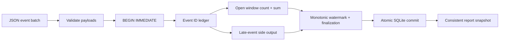

# WindowFlow

[](https://github.com/brohum10/windowflow/actions/workflows/ci.yml)

**Events arrive late. Workers restart. Deliveries repeat. Your totals should still make sense.**

WindowFlow is a small, durable event-time aggregation engine built with Python and SQLite. It groups integer measurements into keyed tumbling windows, retains late events for inspection, and atomically commits its event ledger, aggregates, and watermark. Replaying a committed event ID with the same payload does not change the result.

This is an educational single-machine engine, not a Kafka/Flink replacement or a distributed exactly-once system. It has no third-party runtime dependencies.

## Five-minute demo

Requires Python 3.11+:

```sh
python3 windowflow.py --db demo.sqlite init --window-ms 1000 --lateness-ms 500
python3 windowflow.py --db demo.sqlite ingest examples/events.json
python3 windowflow.py --db demo.sqlite report
python3 windowflow.py --db demo.sqlite ingest examples/events.json
python3 windowflow.py --db demo.sqlite advance 2000
python3 windowflow.py --db demo.sqlite report
python3 -m unittest discover -s tests -v
```

The first ingest reports **4 accepted, 1 late, 1 duplicate**. Window `[0,1000)` has count **3**, sum **40**. A later event advances the watermark to 1100, closing that window; the late value 99 is retained separately and does not change its sum. Replaying the file reports **6 duplicates** and leaves the aggregates unchanged. Advancing to 2000 explicitly closes the final window.

Use a fresh database filename for a new demo. Configuration is immutable; initialization with different settings fails instead of resetting data.

For the installed `windowflow` command, create a virtual environment and run `python -m pip install .` inside it. No account, API key, or server is required.

## Architecture



### Event contract

```json
{"id":"request-1","key":"checkout","timestamp_ms":100,"value":12}
```

All four fields are required and unknown fields are rejected. IDs and keys are nonblank strings. Timestamps are nonnegative integer milliseconds; values are signed integers within the documented SQLite-safe range enforced by the CLI. Overflow in a window count or sum fails the whole batch instead of silently converting the total to a floating-point number.

- IDs are globally unique within one database, not just within a key or window.
- An identical retry is a no-op, including retries of late events.
- An ID reused with a different key, timestamp, or value rejects and rolls back the entire batch.
- The entire JSON array is one transaction. Ingest order is significant; batch boundaries preserve results for the same event sequence.

### Event-time semantics

Windows are half-open: `[floor(timestamp / width) × width, start + width)`. The automatic watermark is `max(previous watermark, max accepted timestamp − lateness, 0)`.

A new event is late when **its window end is at or before the current watermark**. This is a window-closure policy: an event older than the watermark can still enter a window that remains open. Finalized windows never receive updates. The watermark advances as each accepted event is processed, including within a batch.

The watermark is global across keys. A far-future event can close windows for other keys; there is no per-partition watermark, idle-source detection, or clock-skew guard. Validate timestamps upstream. `advance` is an explicit assertion that older windows can close, not a wall-clock timer; it cannot move backwards.

### Durability boundary

SQLite WAL, `synchronous=FULL`, and `BEGIN IMMEDIATE` serialize writers and commit the ledger, windows, and watermark together. Each worker opens its own connection. Reports use a consistent read transaction. Writers wait up to 10 seconds for locks, then surface an error; there is no application retry loop.

The guarantee is **idempotent local state transitions while event IDs are retained**. It does not extend to an external message broker or sink. If a client loses the response after commit, it can retry the same IDs. The process-exit test demonstrates uncommitted rollback, not resilience to every power-loss or filesystem failure. Do not place the database on unsupported network filesystems or share one connection between threads.

## Verification and measured results

Tests cover:

- out-of-order input, exact window boundaries, finalization, and late-event retention;
- duplicate replay after reopen, conflicting IDs, and immutable configuration;
- **24 concurrent deliveries of one ID** producing one update and 23 duplicates;
- **40 concurrent distinct deliveries** without lost updates;
- injected SQLite write failure, whole-batch rollback, and abrupt subprocess exit;
- integer overflow, malformed JSON, and CLI behavior;
- **1,000 generated events** checked against an independent offline aggregation oracle;
- identical results across one-batch versus per-event ingestion of a seeded event sequence.

Run the reproducible benchmark:

```sh
python3 benchmark.py --events 10000 --runs 3 --batch-size 250 --output benchmark-results.json
```

[Recorded local results](benchmark-results.json) include every sample, interpreter/platform, batch size, and throughput. Every run checks all 10,000 events were accepted, then replays them and verifies 10,000 duplicates with identical aggregate state. Timings include commits but exclude network transport and downstream publication; they are synthetic local measurements, not production throughput.

## Resume / interview framing

**WindowFlow — Durable Event-Time Aggregation Engine | Python, SQLite, SQL, Concurrency**

- Built an event-time aggregation engine with keyed tumbling windows, monotonic watermarks, and late-event side outputs, atomically persisting event IDs and aggregates in SQLite WAL transactions.
- Verified duplicate-safe recovery and concurrent writes through fault-injection tests, abrupt-process-exit rollback, 24 competing duplicate deliveries, and a 1,000-event aggregation oracle.

Use these bullets only if you can explain the transaction boundary, window-closure policy, and why the guarantee is local rather than end-to-end exactly-once. Add throughput only with the workload and batch-size context from the recorded benchmark.

## Limits and next steps

All IDs, late events, and windows are retained indefinitely. No retention/compaction policy, authentication, encryption layer, broker adapter, distributed coordination, external sink, or schema migration beyond version 1 is implemented. Reports and input batches are fully buffered in memory. Finalization scans open windows through an index; SQLite remains a single-writer engine.

Next: partition-aware watermarks, retention with an explicit deduplication horizon, crash-tested sink/outbox delivery, and bounded-memory ingestion. Input payloads and reports can contain sensitive keys; sanitize before sharing. This repository contains synthetic examples only.

Built as a learning and portfolio project with AI assistance. MIT licensed.
